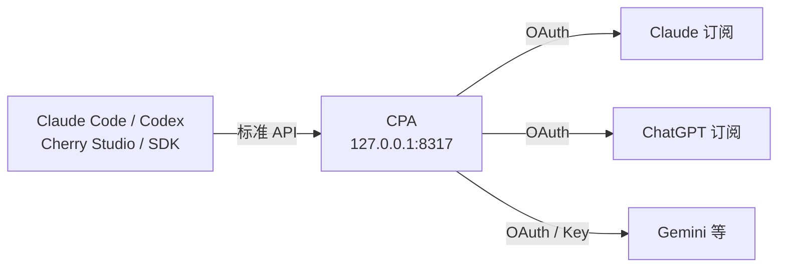

> [!NOTE]
> 国外工具在国内使用需要代理，见 [科学上网入门](/blog/2026/10/13/proxy-guide/)。

## 1. 对比

### 1.1 国外

| 工具 | 厂商 | 形态 | 订阅 | 特点 |
|--|--|--|--|--|
| **[Claude Code](https://docs.anthropic.com/en/docs/claude-code/overview)** | Anthropic | CLI / 桌面 / IDE 插件 | Pro $20 / Max $100、$200 | Agent 能力强，插件、Skills、Hooks、MCP 生态最全 |
| **[Codex](https://github.com/openai/codex)** | OpenAI | CLI / 桌面 / IDE 插件 | ChatGPT Plus $20 / Pro $200 | CLI 开源，Plus 额度相对宽松 |
| [Gemini CLI](https://github.com/google-gemini/gemini-cli) | Google | CLI / IDE 插件 | Google 账号免费额度 | 免费、上下文长 |
| [Cursor](https://cursor.com/) | Anysphere | IDE | Pro $20 起 | VS Code 改版，补全 + Agent 一体 |

### 1.2 国内

| 工具 | 厂商 | 形态 | 价格 | 特点 |
|--|--|--|--|--|
| [Trae](https://www.trae.cn/) | 字节 | IDE / 插件 / CLI | 国内版免费 | 国内版接豆包、DeepSeek、Kimi 等，无需代理 |
| [Qoder](https://qoder.com/) | 阿里 | IDE / CLI | 有免费额度 | Agent 能力为主，自动生成项目知识库 |
| [WorkBuddy](https://www.workbuddy.ai/) | 腾讯 | 桌面 / CLI | 有免费额度 | CodeBuddy 升级而来，编程 + 办公的桌面智能体 |
| [ZCode](https://zcode-ai.com/) | 智谱 | 桌面 | 免费，模型需 GLM Coding Plan | 自研 Agent 内核，深度适配 GLM，已开源 |
| [DSH](https://github.com/deepseek-ai/deepseek-harness) | DeepSeek | Web UI | 开源，按 API 计费 | DeepSeek Harness，官方 Agent 框架，默认 V4 Flash |
| [MiMo Code](https://github.com/XiaomiMiMo/mimo-code) | 小米 | CLI | 开源，MiMo 模型限时免费 | OpenCode 改版，持久记忆、语音输入 |
| [Qwen Code](https://github.com/QwenLM/qwen-code) | 阿里 | CLI | 有免费额度 | Gemini CLI 改版，适配通义千问 |
| [Kimi CLI](https://github.com/MoonshotAI/kimi-cli) | 月之暗面 | CLI | Kimi 会员 / API | 官方终端 Agent |

国内模型（DeepSeek、Kimi、GLM、Qwen 等）大多提供 **Anthropic 兼容 API**，可以直接接进 Claude Code 用，配合下文 CC Switch 切换最方便。

### 1.3 CLI vs 桌面版

| | CLI | 桌面版 |
|--|--|--|
| 上手 | 要会终端 | 图形界面，点点就行 |
| 看改动 | 终端里看 diff | 内置 diff / 文件 / 预览面板 |
| 多任务 | 开多个终端 | 侧边栏管理多个会话，可并行 |
| 自动化 | 能写脚本、接 CI、跑在服务器上 | 不行 |
| 远程 / SSH | 原生支持 | 有限 |
| 配置 | 改 JSON / TOML 文件 | 设置页 |

**结论：新手和日常开发用桌面版；服务器、脚本、CI 用 CLI。** 两者共用同一份配置和登录状态，可以混用。

## 2. 安装

### 2.1 Claude Code

**桌面版**：[claude.ai/download](https://claude.ai/download) 下载 Windows / macOS 安装包，登录后切到 **Code** 标签页。

**CLI**：

```bash
# macOS / Linux / WSL
curl -fsSL https://claude.ai/install.sh | bash
```

```powershell
# Windows PowerShell
irm https://claude.ai/install.ps1 | iex
```

```bash
# 或 npm（需要 Node 18+）
npm install -g @anthropic-ai/claude-code
```

在项目目录运行 `claude`，按提示登录。

### 2.2 Codex

**桌面版**：官网 [openai.com/codex](https://openai.com/codex/) 下载。国内快速下载（第三方镜像，自动指向各架构最新版）：

| 平台 | 链接 |
|--|--|
| Windows（自动） | [win](https://codexapp.agentsmirror.com/latest/win) |
| Windows x64 | [win-x64](https://codexapp.agentsmirror.com/latest/win-x64) |
| Windows ARM64 | [win-arm64](https://codexapp.agentsmirror.com/latest/win-arm64) |
| Apple 芯片 Mac | [mac-arm64](https://codexapp.agentsmirror.com/latest/mac-arm64) |
| Intel Mac | [mac-intel](https://codexapp.agentsmirror.com/latest/mac-intel) |
| 校验和 / Manifest | [checksums](https://codexapp.agentsmirror.com/latest/checksums) / [manifest](https://codexapp.agentsmirror.com/latest/manifest) |

> [!WARNING]
> 非官方渠道，下载后对照校验和再安装。

**CLI**：

```bash
npm install -g @openai/codex
# 或 macOS
brew install --cask codex
```

运行 `codex`，选 **Sign in with ChatGPT**。

### 2.3 Gemini CLI

```bash
npm install -g @google/gemini-cli
```

运行 `gemini`，用 Google 账号登录。

### 2.4 国内工具

Trae、Qoder、WorkBuddy、ZCode 去官网下载安装包。CLI / Web：

```bash
npx @deepseek-ai/dsh web              # DSH，浏览器打开 http://127.0.0.1:3080
npm install -g @mimo-ai/cli           # MiMo Code，运行 mimo
npm install -g @qwen-code/qwen-code   # Qwen Code，运行 qwen
uv tool install kimi-cli              # Kimi CLI，运行 kimi
```

## 3. CC Switch

[CC Switch](https://github.com/farion1231/cc-switch) 是开源桌面工具，**一键切换 Claude Code / Codex / Gemini CLI 等的 API 供应商**，不用手改 `settings.json`、`config.toml`。

- 内置 90+ 供应商预设（官方、中转站、国产模型等），托盘菜单一键切换
- 本地路由：格式转换（如在 Claude Code 里用 GPT）、故障自动切到备用供应商
- 统一管理 MCP、Skills、Prompts，同步到各工具
- 查看用量、费用、会话历史

安装：

| 系统 | 方式 |
|--|--|
| Windows | [Releases](https://github.com/farion1231/cc-switch/releases) 下载 `.msi` |
| macOS | `brew install --cask cc-switch` |
| Linux | Releases 下载 `.deb` / `.rpm` / `.AppImage` |

用法：打开 → 选工具（Claude Code / Codex）→ 添加供应商（选预设，填 API Key）→ 点「启用」→ 重开终端里的 `claude` / `codex`。

## 4. CLIProxyAPI（CPA）

[CLIProxyAPI](https://github.com/router-for-me/CLIProxyAPI) 把 **Claude Code、Codex、Gemini 等订阅账号的 OAuth 登录** 包装成标准 API（OpenAI / Claude / Gemini 格式），供任意工具或 SDK 调用。



适合：一个订阅给多个工具用、多账号轮询、在 Claude Code 里用 GPT。

> [!WARNING]
> 用订阅账号对外提供 API 可能违反服务条款，有封号风险，自用为主。

### 4.1 安装

```bash
# macOS
brew install cliproxyapi
brew services start cliproxyapi

# Linux
curl -fsSL https://raw.githubusercontent.com/router-for-me/cliproxyapi-installer/refs/heads/master/cliproxyapi-installer | bash

# Docker
docker run --rm -p 8317:8317 \
  -v ./config.yaml:/CLIProxyAPI/config.yaml \
  -v ./auth:/root/.cli-proxy-api \
  eceasy/cli-proxy-api:latest
```

Windows 从 [Releases](https://github.com/router-for-me/CLIProxyAPI/releases) 下载直接运行。

### 4.2 桌面版 EasyCPA

[EasyCLIProxyAPI](https://github.com/router-for-me/EasyCLIProxyAPI)（EasyCPA）是官方桌面版，**不用碰命令行和配置文件**，推荐新手用：

- 内置 CPA 内核，一键启动 / 停止，自动更新
- 浏览器授权登录 Codex、Claude、Kimi 等账号
- 一键把 Claude Code、Codex 等接到本地代理，自动备份原配置
- 统计请求数、Token、成功率、预估费用，查看额度

安装：[Releases](https://github.com/router-for-me/EasyCLIProxyAPI/releases) 下载（Windows `.zip`、macOS `.dmg`、Linux `.tar.gz`）→ 打开 → **版本管理** 安装内核 → **首页** 启动内核并登录账号 → 在 Agent 配置里一键接入。

用了桌面版，下面 4.3–4.5 的手动配置可以跳过。

### 4.3 配置与登录

`config.yaml` 关键项：

```yaml
server:
  port: 8317
oauth:
  auth-dir: "~/.cli-proxy-api"
access:
  api-keys:        # 客户端调用 CPA 时用的 key，自己随便定
    - "my-key"
```

登录订阅账号（浏览器授权）：

```bash
./cli-proxy-api --codex-login    # ChatGPT
./cli-proxy-api --claude-login   # Claude
```

> [!TIP]
> 字段名和登录参数随版本变化，以仓库里的 `config.example.yaml` 和 [文档](https://help.router-for.me/) 为准。

### 4.4 接入 Claude Code

`~/.claude/settings.json`：

```json
{
  "env": {
    "ANTHROPIC_BASE_URL": "http://127.0.0.1:8317",
    "ANTHROPIC_AUTH_TOKEN": "my-key"
  }
}
```

### 4.5 接入 Codex

`~/.codex/config.toml`：

```toml
model_provider = "cliproxyapi"

[model_providers.cliproxyapi]
name = "cliproxyapi"
base_url = "http://127.0.0.1:8317/v1"
wire_api = "responses"
```

`~/.codex/auth.json` 里 `OPENAI_API_KEY` 填 `my-key`。

> [!TIP]
> 这些配置也可以交给 CC Switch：添加一个自定义供应商，地址填 `http://127.0.0.1:8317`，两者配合使用。

## 5. 怎么选

| 需求 | 方案 |
|--|--|
| 只用一个工具 | 直接订阅登录，不需要额外工具 |
| 多个 API Key / 中转站来回切 | **CC Switch** |
| 一份订阅给多个工具用、多账号轮询 | **CPA** |
