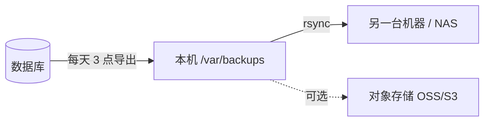

小型 Web 项目（比如 Django + MySQL 的前后端分离站点）上线以后，最容易被忽略的就是备份。
不需要在程序里写备份功能，数据库自带的导出命令加系统自带的 `cron` 就够了。本文以 Linux 服务器为例，
MySQL、PostgreSQL、SQLite 都覆盖到，直接装在服务器上和用 Docker 部署的都能用。

## 1. 先搞清楚要备份什么

| 内容 | 要不要备份 | 原因 |
|--|--|--|
| **数据库** | **要，这是核心** | 业务数据全在里面，丢了就真没了 |
| 配置文件（如 `.env`） | 要，存一份，变了再存 | 里面的密钥丢了，用户登录态全部失效 |
| 用户上传的文件 | 看情况 | 存在磁盘上（`MEDIA_ROOT`）就要一起备；解析完就丢的不用 |
| 代码 | 不用 | 已经在 git 里 |

> [!TIP]
> 先查一下项目里有没有 `FileField` / `ImageField`、`MEDIA_ROOT` 之类的配置。
> 没有的话，要备份的就只有数据库，事情简单很多。

几条原则，后面每一步都围绕它们：

- **别直接复制数据文件。** 库正在写的时候复制出来的文件可能是坏的，要用数据库自己的导出命令
- **只放本机等于没备份。** 硬盘坏了、服务器被删了，备份跟着一起没
- **Docker 的数据卷也不是备份。** 卷只保证删容器时数据不丢，`docker compose down -v`、误删卷、硬盘坏了，数据照样没
- **没恢复过的备份不算备份。** 见第 7 节

## 2. 导出命令

| 数据库 | 导出命令 | 应用跑着能不能导 |
|--|--|--|
| MySQL | `mysqldump` | 能，加 `--single-transaction` 不锁表（InnoDB） |
| PostgreSQL | `pg_dump` | 能，默认就是一致的快照 |
| SQLite | `sqlite3 ... .dump` | 能，导出时会在一个读事务里完成 |

三条命令都把 SQL 输出到标准输出，接上 `| gzip > 文件` 就是一份备份。下面分别说每种的坑。

### 2.1 MySQL

```bash
mysqldump --single-transaction --routines --triggers --default-character-set=utf8mb4 mydb | gzip > mydb.sql.gz
```

| 参数 | 作用 |
|--|--|
| `--single-transaction` | 在一个事务里读出一致的快照，**InnoDB 上不锁表**，备份时网站照常用 |
| `--routines` | 连存储过程、函数一起导出 |
| `--triggers` | 连触发器一起导出（默认就开，写上更明确） |
| `--default-character-set=utf8mb4` | MySQL 5.7 默认字符集不是 utf8mb4，不写的话 emoji 之类的字符可能导出成乱码 |
| `gzip` | 文本 SQL 压缩比很高，通常能小到十分之一 |

**密码别写在命令里。** 写在命令行里的密码会出现在 `ps` 和 shell 历史里。
在跑备份的那个用户家目录下建 `~/.my.cnf`，之后 `mysqldump`、`mysql` 都会自动读它：

```ini
[client]
user=backup
password=你的密码
```

```bash
chmod 600 ~/.my.cnf   # 只有自己能读
```

**单独建一个只读的备份账号**，别用 root：

```sql
CREATE USER 'backup'@'localhost' IDENTIFIED BY '你的密码';
GRANT SELECT, SHOW VIEW, TRIGGER, LOCK TABLES, PROCESS ON *.* TO 'backup'@'localhost';
```

这个账号只能读，**恢复的时候用不了**，恢复要用有写权限的账号，见第 6 节。

### 2.2 PostgreSQL

```bash
sudo -u postgres pg_dump mydb | gzip > mydb.sql.gz
```

`pg_dump` 不用加参数就是一致的快照，也不锁表。以系统的 `postgres` 用户身份运行，本机连接不需要密码。

### 2.3 SQLite

Django 默认的 `db.sqlite3` 就是 SQLite，整个库只有一个文件。

```bash
sudo apt install sqlite3   # 没装命令行工具的话
sqlite3 /opt/myapp/db.sqlite3 .dump | gzip > db.sql.gz
```

> [!WARNING]
> **别直接 `cp` 数据库文件。** 应用正在写的时候复制出来的可能是半截的；开了 WAL 模式的话，
> 最近的改动还在旁边的 `db.sqlite3-wal` 里，只复制主文件会丢数据。

跑备份的用户要能读写数据库文件**所在的目录**（WAL 模式下读库也要建 `-shm` 文件），
用 root 或者和应用同一个用户跑就行。

### 2.4 用 Docker 部署的

数据库跑在容器里（部署方式见 [Docker 上手](/blog/2026/09/24/docker-guide/)）时，
在宿主机上给上面的命令加个前缀 `docker compose exec -T 服务名`，进容器执行，输出照样落在宿主机上：

```bash
# MySQL：官方镜像的 root 密码在容器的环境变量里，直接拿来用
docker compose -f /opt/myapp/docker-compose.yml exec -T db sh -c \
  'exec mysqldump -uroot -p"$MYSQL_ROOT_PASSWORD" --single-transaction --routines --triggers --default-character-set=utf8mb4 mydb' \
  | gzip > mydb.sql.gz

# PostgreSQL：容器里用 postgres 用户连本机不需要密码
docker compose -f /opt/myapp/docker-compose.yml exec -T db pg_dump -U postgres mydb | gzip > mydb.sql.gz
```

- **`-T` 一定要加**：不加的话 compose 会给命令分配一个终端，输出里的换行会变成 `\r\n`，导出来的 SQL 就坏了
- **MySQL 那条用单引号**：`$MYSQL_ROOT_PASSWORD` 要在容器里展开，宿主机上没有这个变量
- **`-f` 写全路径**：cron 的工作目录是用户家目录，不写的话 compose 找不到 yml 文件
- 用 Docker 时不用建 `~/.my.cnf`，也不用单独建备份账号

**SQLite 在容器里的话，一定要把数据库所在目录挂到宿主机**，不然重建容器数据就没了：

```yaml
  backend:
    volumes:
      - ./data:/app/data   # 数据库路径配成 /app/data/db.sqlite3
```

挂出来以后它在宿主机上就是 `/opt/myapp/data/db.sqlite3`，直接用 2.3 节的命令，不需要进容器。

## 3. 备份脚本

把导出命令包成脚本，顺带处理文件命名、过期清理和异地复制。
**不管用哪种数据库，都只需要改 `dump` 里那一行**，换成第 2 节对应的命令：

```bash
#!/bin/bash
# 数据库每日备份
set -euo pipefail

NAME=${BACKUP_NAME:-mydb}
DIR=${BACKUP_DIR:-/var/backups/$NAME}
KEEP_DAYS=${BACKUP_KEEP_DAYS:-30}

# 换成第 2 节对应的导出命令（不带 | gzip）
dump() {
    mysqldump --single-transaction --routines --triggers --default-character-set=utf8mb4 mydb
}

mkdir -p "$DIR"
chmod 700 "$DIR"  # 备份里是完整的业务数据
FILE="$DIR/$NAME-$(date +%F-%H%M).sql.gz"
trap 'rm -f "$FILE.part"' EXIT
# 先写临时文件，导出中途失败不会留下一个看着正常的半截备份
dump | gzip > "$FILE.part"
mv "$FILE.part" "$FILE"
find "$DIR" -maxdepth 1 -name "$NAME-*.sql.gz" -mtime +"$KEEP_DAYS" -delete

# 异地一份：BACKUP_REMOTE=user@host:/path，不设就只留本机
if [ -n "${BACKUP_REMOTE:-}" ]; then
    rsync -a "$FILE" "$BACKUP_REMOTE/"
fi
```

几个容易踩的坑，脚本里都处理了：

> [!WARNING]
> **一定要 `set -o pipefail`。** 不加的话，导出命令连不上库报错了，
> 后面的 `gzip` 照样成功退出，整条管道算成功——你会得到一个只有几十字节的「备份」，还以为一切正常。
> `pipefail` 只有 bash 支持，所以第一行要写 `#!/bin/bash`，不能写 `#!/bin/sh`。

- **先写 `.part` 再 `mv`**：导出中途失败时不会留下文件名看着正常的半截备份；`trap` 负责把 `.part` 清掉
- **文件名带时间**：`mydb-2026-10-14-0300.sql.gz`，按名字排序就是按时间排序
- **`find -mtime +30 -delete`**：只留 30 天，不然迟早把盘写满；`-maxdepth 1` 只清当前目录，不碰子目录里手动存的备份
- **目录 700**：备份里有用户手机号这类敏感数据，别让其他用户读到

> [!IMPORTANT]
> 脚本如果是在 Windows 上写的，要确认换行符是 **LF**。CRLF 的脚本到 Linux 上会报
> `/bin/bash^M: bad interpreter`。放在 git 仓库里的话，加一个 `.gitattributes`：
>
> ```
> *.sh text eol=lf
> ```
>
> 并记得给可执行权限：`git update-index --chmod=+x backup.sh`。

## 4. 用 cron 定时跑

先想好**用哪个用户跑**。脚本要写 `/var/backups` 和 `/var/log`，普通用户没权限；
MySQL 的 `~/.my.cnf` 也必须放在这个用户的家目录下，用 Docker 的话这个用户还得能执行 `docker`。
最省事的是用 root 跑，配置文件就是 `/root/.my.cnf`：

```bash
sudo crontab -e
```

> [!NOTE]
> 不想用 root，就建一个专门的系统用户，把备份目录和日志文件的属主改成它
> （用 Docker 的话再把它加进 `docker` 组），然后用 `sudo crontab -u 用户名 -e`。

加一行，每天凌晨 3 点跑，输出记进日志：

```
0 3 * * * /opt/myapp/backup.sh >> /var/log/mydb-backup.log 2>&1
```

cron 的五个字段依次是 **分 时 日 月 周**：

| 写法 | 含义 |
|--|--|
| `0 3 * * *` | 每天 03:00 |
| `0 */6 * * *` | 每 6 小时 |
| `30 2 * * 0` | 每周日 02:30 |

> [!NOTE]
> cron 运行时的环境变量很少，`PATH` 也很短。脚本里用到的命令找不到时，
> 先看日志，再考虑在脚本开头写全 `PATH` 或用命令的绝对路径。

## 5. 备份放在哪里



- **本机一份**：误操作时恢复最快
- **另一台机器再一份**：脚本里设 `BACKUP_REMOTE=user@host:/path`，先配好免密 ssh（`ssh-copy-id user@host`）
- **传到外面先加密**：备份里是完整业务数据，传到第三方存储前用 `gpg -c` 加个密码

**用户上传的文件**和数据库放在一起备。在宿主机目录里的直接打包：

```bash
tar czf /var/backups/mydb/media-$(date +%F).tar.gz -C /opt/myapp/media .
```

放在 Docker 命名卷里的，用一个临时容器把卷打包：

```bash
docker run --rm -v myapp_media:/data:ro -v /var/backups/mydb:/backup alpine \
  tar czf /backup/media-$(date +%F).tar.gz -C /data .
```

卷的完整名字用 `docker volume ls` 查，compose 会自动加上项目名前缀（比如 `myapp_media`）。
放进备份脚本的话，记得照着给 `media-*.tar.gz` 也加一行 `find ... -delete`，不然这些压缩包会一直堆着。

## 6. 出事怎么恢复

### 6.1 先选手段

原则是**从小到大选**，能用小手段解决的就不动整库。

| 出了什么事 | 怎么办 |
|--|--|
| 导错了一批数据 | 应用自己有撤销功能就用它，影响范围最小 |
| 只丢了一部分数据 | 恢复到临时库里，挑出需要的数据再导回去（6.4） |
| 发版出问题 | 先退数据库迁移再回退代码，退不回去就用发版前的备份（6.5） |
| 数据大面积坏了（误删、脚本跑错） | 整库恢复（6.2、6.3）。**备份时间点之后的改动会丢** |

### 6.2 整库恢复的通用流程

不管哪种数据库，都是这四步：

```bash
# 1. 停掉应用，别让人在恢复中途写数据（数据库本身要开着）
sudo systemctl stop myapp          # Docker：docker compose stop backend

# 2. 先把现在的状态也备一份，恢复错了还能回来
sudo BACKUP_DIR=/var/backups/mydb-before-restore /opt/myapp/backup.sh

# 3. 删库重建，导入备份（命令见 6.3）

# 4. 启动应用
sudo systemctl start myapp         # Docker：docker compose start backend
```

> [!CAUTION]
> 第 2 步别省。恢复操作本身也可能选错文件、恢复错库，
> 恢复前多存一份当前状态，才有「撤销这次恢复」的机会。

**为什么要先删库：** 备份里只有备份时存在的表，导入时只会覆盖这些表。
备份之后才新建的表（比如新迁移加的）会原样留下来，和恢复出来的数据对不上。

### 6.3 各数据库的恢复命令

> [!IMPORTANT]
> 2.1 节的 MySQL `backup` 账号只能读，恢复要用**有写权限的账号**，比如 `mysql -u root -p`。

**MySQL**

```bash
mysql -u root -p -e 'DROP DATABASE mydb; CREATE DATABASE mydb CHARACTER SET utf8mb4'
gunzip < /var/backups/mydb/mydb-2026-10-14-0300.sql.gz | mysql -u root -p mydb
```

**PostgreSQL**

```bash
sudo -u postgres dropdb mydb
sudo -u postgres createdb mydb
gunzip < /var/backups/mydb/mydb-2026-10-14-0300.sql.gz | sudo -u postgres psql mydb
```

**SQLite**

```bash
cd /opt/myapp
rm -f db.sqlite3 db.sqlite3-wal db.sqlite3-shm
gunzip < /var/backups/mydb/mydb-2026-10-14-0300.sql.gz | sqlite3 db.sqlite3
sudo chown myapp: db.sqlite3   # 属主改回应用的运行用户
```

> [!CAUTION]
> SQLite 的 `-wal`、`-shm` 文件一定要一起删。旧的 `-wal` 留着的话，SQLite 打开时会把它套到恢复出来的库上，
> 轻则数据对不上，重则直接把库搞坏。

**用 Docker 部署的**，和导出一样，给命令加上 `docker compose exec -T 服务名` 前缀。MySQL 的密码写法容易弄错，完整写出来：

```bash
docker compose exec -T db sh -c 'exec mysql -uroot -p"$MYSQL_ROOT_PASSWORD" -e "DROP DATABASE mydb; CREATE DATABASE mydb CHARACTER SET utf8mb4"'
gunzip < mydb-2026-10-14-0300.sql.gz | docker compose exec -T db sh -c 'exec mysql -uroot -p"$MYSQL_ROOT_PASSWORD" mydb'
```

PostgreSQL 容器里如果库名就叫 `postgres`（官方镜像的默认库），`dropdb` 和 `createdb` 要加 `--maintenance-db=template1`，
因为删库时不能连着被删的那个库，而它们默认连的正是 `postgres`。
SQLite 挂在宿主机目录里，直接用上面的命令，不需要进容器。

### 6.4 只捞回一部分

比如误删了几条记录，没必要把整个库退回昨天。把备份恢复到一个临时库里，查到要的数据再导回正式库。

**MySQL**：建临时库，用 `INSERT ... SELECT` 跨库导回：

```bash
mysql -u root -p -e 'CREATE DATABASE mydb_restore CHARACTER SET utf8mb4'
gunzip < mydb-2026-10-14-0300.sql.gz | mysql -u root -p mydb_restore
```

```sql
INSERT INTO mydb.orders SELECT * FROM mydb_restore.orders WHERE id IN (101, 102);
```

**PostgreSQL**：同样先 `createdb mydb_restore` 导进去。PostgreSQL 不能直接跨库查询，
用 `COPY` 把要的数据导成 CSV，再导进正式库：

```bash
sudo -u postgres psql mydb_restore -c "\copy (SELECT * FROM orders WHERE id IN (101, 102)) TO '/tmp/rows.csv' CSV"
sudo -u postgres psql mydb -c "\copy orders FROM '/tmp/rows.csv' CSV"
```

**SQLite**：恢复成一个临时文件，`ATTACH` 进来就能跨库查：

```bash
gunzip < mydb-2026-10-14-0300.sql.gz | sqlite3 /tmp/restore.sqlite3
sqlite3 /opt/myapp/db.sqlite3
```

```sql
ATTACH '/tmp/restore.sqlite3' AS old;
INSERT INTO main.orders SELECT * FROM old.orders WHERE id IN (101, 102);
DETACH old;
```

用完把临时库（或临时文件）删掉。

### 6.5 发版回滚

发版前**手动跑一次备份脚本**，这是成本最低的保险。以 Django 为例，发版出问题时：

```bash
python manage.py migrate <app> <上一个迁移号>   # 这次发版带了迁移才需要
git checkout <上一个版本>
```

> [!WARNING]
> **顺序不能反。** 退迁移要用到新版本里的迁移文件，先切回旧代码的话，
> Django 找不到这些文件，就不知道怎么撤销。

迁移退不回去（比如删了字段、数据已经变了），就用发版前那份备份整库恢复。

## 7. 两个容易忽略的点

**定期真的恢复一次。** 每个月往临时库里恢复一份，看看表在不在、数据对不对。
从没恢复过的备份不算备份——可能早就是空文件，或者缺了某张表。

**每天一备够不够？** 每日备份意味着最坏情况丢一天的数据。扛不住的话，MySQL 可以开 binlog、
PostgreSQL 可以开 WAL 归档，都能恢复到任意时间点；SQLite 没有这个功能，只能多备几次，比如每小时一次。
对数据量不大、改动不频繁的内部系统，每日一备通常就够了。
