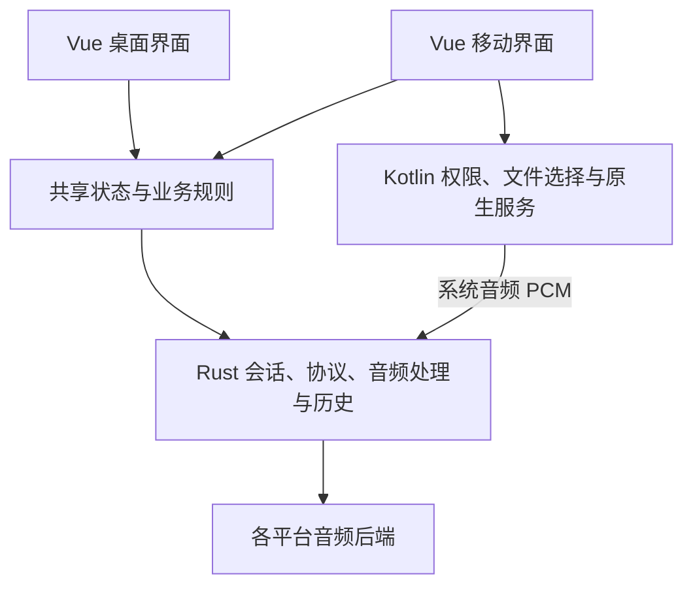

把 Tauri 桌面应用带到 Android，页面能缩小、Rust 能编译只是开始。真正影响可用性的，往往是录音上下文、权限弹窗、后台服务、文件 URI 和安装包身份。

这篇记录 [ReaLingo](https://github.com/noSugarK/ReaLingo) 的跨平台实践：**共享音频处理与会话规则，把系统能力放回对应的原生层，桌面和移动端分别组织交互。**

依据为 2026-11-09 源码快照 `c01e68e`，应用版本 `0.8.0`，使用 Vue 3、Tauri 2.12 和 cpal 0.17。下文版本要求均有具体案例条件，升级依赖后需要重新核对。本次为源码与开发记录整理，没有重新构建或实机运行应用。

系列另两篇：[系统声音与自身朗读过滤]()、[实时会话、字幕与验证]()。

## 1. 共享什么，先按职责决定

项目保留同一套 Rust 音频处理、协议适配与历史数据逻辑，Vue 的共享状态也没有按平台复制。界面分别放在 `src/desktop` 和 `src/mobile`，Android 系统交互放在 Kotlin。



| 层 | 项目中的例子 | 这样划分的收益 |
| --- | --- | --- |
| 共享前端规则 | `src/core/session.ts`、`stream.ts`、`store.ts` | 字幕配对、设置、导出规则保持一致 |
| 平台界面 | `desktop/App.vue`、`mobile/MobileApp.vue` | 桌面多栏与手机抽屉各自适配交互 |
| Rust 业务与状态 | `lib.rs`、`realtime.rs`、`history.rs` | 资源、网络任务和权威会话状态集中管理 |
| Android 系统桥 | `MainActivity.kt`、`SubtitleService.kt` | 权限、Activity、SAF、投影与悬浮窗直接调用系统 API |

项目曾尝试通过 Rust JNI 获取 Activity 处理部分界面能力，后来改为 Kotlin WebView bridge。具体原因是当时的 Tauri `AppHandle` 没有适合这条调用链的稳定 Activity 访问入口，JNI 生命周期又增加了维护成本。这是该项目的取舍，不代表所有 Tauri Android 项目都需要自建桥；已有插件能覆盖需求时，可以优先采用。

## 2. 编译边界用 cfg，功能入口用能力报告

Rust 依赖按目标拆分：Windows bindings 只进入 Windows，Core Audio/Objective-C 只进入 macOS，桌面 keyring 不进入 Android，Android 使用自己的 TLS 组合。

```toml
# 结构示意，具体版本见项目 Cargo.toml
[target.'cfg(not(target_os = "android"))'.dependencies]
tokio-tungstenite = { version = "0.29.0", features = ["native-tls"] }

[target.'cfg(target_os = "android")'.dependencies]
tokio-tungstenite = { version = "0.29.0", features = ["rustls-tls-webpki-roots"] }
```

Android 的 `target_os` 是 `android`，不能因为它使用 Linux 内核，就把桌面 Linux 的 `pactl`、托盘或窗口管理逻辑直接放进去。

前端通过 Rust `platform` command 获取 OS、loopback、keyring 能力。UA 用来尽早选择手机界面，后端返回值再校正；窄窗口不等于手机，Android WebView 也不只是一个窄浏览器。

能力还会变化：Linux 声音服务器是否可达是运行时条件；Android 系统声音还要额外判断 API 级别和授权。把“系统类型”与“此刻能执行这个操作”分开，错误提示才能准确。

参考：[Cargo.toml](https://github.com/noSugarK/ReaLingo/blob/c01e68ea01545b7ebc27c0a4efc17c0fb6031ac2/src-tauri/Cargo.toml)、[platform.ts](https://github.com/noSugarK/ReaLingo/blob/c01e68ea01545b7ebc27c0a4efc17c0fb6031ac2/src/core/platform.ts)。

## 3. Android 构建最容易混淆的两处约束

### 3.1 APK 最低版本与 Rust 链接等级要一致

项目使用的 cpal 0.17 通过 AAudio 采集麦克风，需要 API 26。历史上遇到过 `-laaudio` 找不到，只调整生成 Gradle 文件仍不能解决。

原因是 APK 声明的 minSdk 和 Rust 交叉链接采用的 API 等级都要正确。Tauri 的 `bundle.android.minSdkVersion` 会影响原生构建，应从配置源头设置，并检查实际 linker 命令与最终 APK manifest。

当前项目配置为：

```json
{
  "bundle": {
    "android": { "minSdkVersion": 26 }
  }
}
```

麦克风后端要求 API 26，不代表系统声音功能也在 API 26 可用；AudioPlaybackCapture 仍要求 API 29。应用能安装的最低版本与某个功能能用的最低版本，需要分别说明。

另一个小坑是凭印象给 cpal 添加 `aaudio` feature。该版本按目标平台选择后端，并没有这个 feature，应查真实 manifest，而不是猜开关名称。

生成的 Android 工程由 `scripts/prepare-android.mjs` 补充配置和原生文件。类似准备脚本应能重复执行，模板变化或匹配失败时要明确报错；同时检查最终生成文件，避免只验证准备脚本里写了什么。

### 3.2 编译成功后，第一次设备枚举仍可能直接退出

项目早期 APK 在第一次 `list_devices` 时发生原生 abort。cpal 的 AAudio 枚举调用了尚未初始化的 `ndk_context::android_context()`，panic 穿过不能 unwind 的 JNI 回调边界，终止整个进程。

[修复提交](https://github.com/noSugarK/ReaLingo/commit/17b7be4)将运行时升级到 Tauri 2.12 / Tao 0.37，由 Activity 启动链路初始化共享 NDK context。验证还需要确认消费者使用同一份 context 依赖，避免看似初始化过，实际是不同依赖实例。

这类错误无法靠桌面测试或成功生成 APK 发现。有效的回归路径是：**安装 release APK，冷启动，打开真实 WebView 页面，触发第一次设备查询。**

在外层异步任务添加 `catch_unwind` 也不能替代修复 JNI 边界里的初始化与参数校验。

设备打开还有一个独立细节：AAudio 的默认设备可能用 `-1` 表示系统路由，并不出现在硬件枚举里。项目在展示列表和查找设备时都额外检查默认设备，避免把“未出现在列表”误判为“不能打开”。是否可用最终由真实采集帧验证。

## 4. ws 正常，不代表 wss 已经配置好

Android 路径使用 rustls 后，项目曾在首次 `wss://` 连接时 panic：已经启用根证书，但缺少可用 CryptoProvider。

根证书回答“信任谁”，加密提供器回答“用什么实现密码算法”。配置其中一个不会自动证明另一个可用。项目显式选择 `ring`，并在初始化阶段安装对应 provider。

验证需要分别覆盖成功 TLS 会话、不可信证书拒绝、握手尚未完成时取消。普通 `ws://` 只证明 WebSocket 传输；把 TLS 连到明文端口只证明失败路径，也不能代替成功握手。

项目把这些路径做成了本地可控测试，见 [realtime.rs](https://github.com/noSugarK/ReaLingo/blob/c01e68ea01545b7ebc27c0a4efc17c0fb6031ac2/src-tauri/src/realtime.rs) 与 [TLS 回归提交](https://github.com/noSugarK/ReaLingo/commit/7893b49)。

## 5. Android 桥接：线程、状态和等待用户

### 5.1 WebView bridge 不在 UI 主线程执行

`@JavascriptInterface` 方法运行在 JavaBridge 线程。项目在需要操作窗口、启动 Activity 或请求权限时使用 `runOnUiThread`；文件复制等长任务交给工作线程。

通过反射调用的桥接类使用 `@Keep`，避免 release 混淆后方法丢失。只测试 debug 包容易漏掉这类故障。

桥接双方还需要明确 JSON 协议。文件选择、系统录音和导出分别表达等待、成功、取消、失败；取消不该被伪装成成功，原生异常也不应只留下界面上的无限转圈。

这些桥接能力只应暴露给可信应用页面。外部网站通过系统 opener 打开，避免应用 WebView 导航到外部内容后仍承载原生能力。

### 5.2 弹窗还开着，不能判定永久拒绝

麦克风权限需要同时考虑 `granted`、`rationale`、以前是否询问过，以及当前是否仍在请求。系统弹窗打开期间，`rationale=false` 不能直接解释为“永久拒绝”。

项目在 Kotlin 维护 `micRequesting`，等权限结果回调后再结束请求状态。前端 30 秒轮询结束时，如果弹窗仍在，就保留 `pendingStart`；用户稍后同意并回到应用，继续检查并完成原本的启动动作。

这里的原则是：**程序停止等待，不等于用户已经作答。** 等待超时应决定界面如何退出忙碌状态，不能凭空生成用户的授权结果。

这是已修复的[长时间授权等待案例](https://github.com/noSugarK/ReaLingo/commit/403466c)，源码在 [perms.ts](https://github.com/noSugarK/ReaLingo/blob/c01e68ea01545b7ebc27c0a4efc17c0fb6031ac2/src/mobile/perms.ts)。

## 6. 文件、窗口与布局都要按原生语义适配

### 6.1 content URI 不能直接交给 Rust 当文件路径

Android SAF 返回的 `content://` URI 由 ContentProvider 提供访问能力，Rust 的普通文件 API 不能直接按路径打开。

项目导入音频时由 Kotlin 通过 ContentResolver 读取，复制到应用缓存，再将真实路径交给解码器；导出 TXT/SRT 则通过系统文档选择器，将内容写入用户选择的 URI。

复用时还应检查文件名清理、缓存冲突、失败残留与大文件复制成本。共享的是解码和导出规则，平台层负责获得输入与输出的访问权。

### 6.2 桌面第二窗口到了 Android，可能变成第二个 Activity

桌面有独立的透明字幕窗口。移动端如果照搬窗口配置，额外 Activity 可能盖住主页面；等启动后再关闭已经太晚。

项目通过 `tauri.android.conf.json` 只声明 `main`，跨应用悬浮字幕则交给原生 overlay。前台服务持有采集和悬浮窗，Activity 负责交互入口，二者的生命周期独立设计。

锁定穿透后还需要从应用内解锁或隐藏的入口。显示权限、透明度、拖拽缩放、旋转、位置保存也要在目标系统验证，不能把桌面的置顶窗口行为直接套到 Android。

### 6.3 手机适配还要覆盖系统栏和长内容

项目使用原生 WindowInsets 处理系统栏与输入法区域。只依靠 CSS `safe-area-inset-*`，在部分 WebView 环境可能得不到预期值。

长字幕列表曾因 flex 尾部对齐产生起点负溢出，滚不回第一条；普通列表和全屏字幕分别修复。短列表截图验证不了这个问题，至少要填充超过一屏的内容，测试顶部、底部和键盘展开状态。

参考：[MainActivity.kt](https://github.com/noSugarK/ReaLingo/blob/c01e68ea01545b7ebc27c0a4efc17c0fb6031ac2/src-tauri/android/MainActivity.kt)、[Android 窗口配置](https://github.com/noSugarK/ReaLingo/blob/c01e68ea01545b7ebc27c0a4efc17c0fb6031ac2/src-tauri/tauri.android.conf.json)、[列表修复](https://github.com/noSugarK/ReaLingo/commit/e535d70)。

## 7. 安装包身份与发布验证

生成 APK 后，仍要检查包名、签名、`versionName`、`versionCode` 和原生库兼容性。能显示应用版本，不代表包的元数据正确。

同包名、同签名且递增的 `versionCode` 才构成正常覆盖升级的基础。临时测试签名与正式签名不同，项目用独立 `.debug` 包名承载测试安装。

项目从 Cargo 版本生成 Android 版本，将 alpha、beta、rc、stable 分配到递增数字槽位，保证同一版本的正式包排在预发布包之后。这套公式有数值范围限制，适合参考设计，不能不加检查地复制到所有版本规划中。

16 KB 页兼容需要检查两层：APK 内 `.so` 的 ZIP 对齐，以及每个原生库的 ELF LOAD 段对齐。文件生成成功或 ARM64 编译通过都不能替代这些检查，更不能替代设备安装启动。

桌面也有自己的安装边界：macOS universal 需要真实合并两套架构；Linux DEB/RPM 要声明目标环境的运行依赖；Windows WiX/MSI 对版本格式有额外限制。项目曾遇到 MSI 不接受 `beta.1` 的问题，此次最终发布数字版 `0.8.0`，没有实现可供照搬的通用预发布版本映射。

## 8. 复用时保留验证层级，也保留当前限制

| 验证 | 可以说明什么 | 仍需补充什么 |
| --- | --- | --- |
| Vue 类型检查、Node/Rust 测试 | 共享逻辑与接口约定 | 目标系统原生行为 |
| Android 交叉编译、release 构建 | 目标依赖、JNI、资源和混淆可构建 | 冷启动、权限、设备采集 |
| APK 元数据与对齐检查 | 成品符合被检查的包约束 | 安装后真实运行 |
| 模拟器与本地服务 | 可控环境中的采集、上传、字幕和停止 | 厂商 API、厂商后台策略与真机路由 |
| 目标硬件实测 | 指定设备和系统上的行为 | 其他设备与系统版本 |

项目的 Android 工作流配置了 API 35 / 4 KB 与 API 36 / 16 KB 冒烟，具体历史记录和复现方式见 [development/android-testing.md](https://github.com/noSugarK/ReaLingo/blob/c01e68ea01545b7ebc27c0a4efc17c0fb6031ac2/development/android-testing.md)。它不等于所有 ARM64 厂商真机都已通过。

还有一处现状要如实保留：该快照 Android 没有接入 keyring 后端，API Key 会回退到应用私有 `settings.json` 明文保存。私有目录有系统沙箱隔离，但不等于 Keystore 加密。后续可用 Android Keystore 保护加密密钥，再加密保存 token，并处理旧明文迁移与清理；这是改进方向，本文不把它写成已经完成的能力。

这项限制可从 [secret.rs](https://github.com/noSugarK/ReaLingo/blob/c01e68ea01545b7ebc27c0a4efc17c0fb6031ac2/src-tauri/src/secret.rs) 和 [store.ts](https://github.com/noSugarK/ReaLingo/blob/c01e68ea01545b7ebc27c0a4efc17c0fb6031ac2/src/core/store.ts) 核对。
