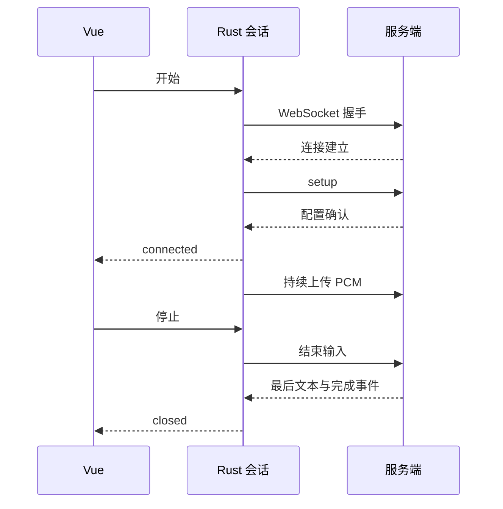

实时翻译里的“开始”和“停止”都不是一次函数调用那么简单。开始时要打开设备、连接网络、确认协议配置；停止时要结束输入，等最后一句，再释放播放器、采集和上传任务。

[ReaLingo](https://github.com/noSugarK/ReaLingo) 的另一组可复用经验，集中在这些时序边界，以及原文、译文、音频分别到达时，如何保持界面和数据一致。

本文依据 2026-11-09 源码快照 `c01e68e`，应用版本 `0.8.0`。下文描述该版本的实现、已有测试和历史修复，本次没有重跑应用测试或查询远端 CI 状态。模型名称、协议字段及采样率属于该快照的适配，接入其他版本时需重新核对服务端规范。

系列前两篇：[系统声音与自身朗读过滤]()、[跨平台与 Android 适配]()。

## 1. 一个统一接口，内部保留真实协议差异

项目把实时连接放在 Rust：部分服务需要在 WebSocket 握手中设置鉴权请求头，浏览器的原生 `WebSocket` 构造器无法任意指定这些头。

不同服务也不只是换一个 URL。项目的 [config.rs](https://github.com/noSugarK/ReaLingo/blob/c01e68ea01545b7ebc27c0a4efc17c0fb6031ac2/src-tauri/src/config.rs) 按协议提供：

- 会话配置、音频包与结束输入消息。
- 目标 PCM 采样率与鉴权形式。
- 配置就绪、拒绝与结束的判断。
- 文本帧、二进制帧的解析入口。

例如，快照中 Qwen/OpenAI 的音频使用 JSON 携带 base64，Volc 路径使用 protobuf 二进制消息；部分服务需要独立的 setup 确认，部分结束后没有同样的完成事件。

将这些差异封装成少量明确的方法，比让整个上传循环到处分支更容易维护。前端收到统一事件，但协议适配层仍要尊重服务真实的开始、就绪和结束语义。

## 2. WebSocket 已连接，不代表可以上传音频

项目将网络连接成功与会话配置确认分开。对要求 ACK 的协议，先发送 setup，收到对应响应后才释放上传任务。



该快照识别的确认包括 Qwen 3.8 的 `session.updated`、Gemini 的 `setupComplete`、Volc 的 `volc.SessionStarted`。不能用任意“session created”消息代替配置确认。

实现中用 `Notify` 开闸，setup 在 10 秒内未确认就报错。若服务端明确拒绝，应立即展示拒绝原因，而不是继续等到通用空闲超时。

这条边界直接影响产品状态：连接期间显示 `connecting`，真正就绪后显示 `connected`，停止收尾显示 `stopping`。把这些阶段都显示为“正在聆听”，用户就无法判断问题发生在设备、网络还是协议配置。

## 3. 停止必须能打断等待，也要给最后一句留机会

### 3.1 停止信号不能只在收到下一包后检查

如果读取循环一直阻塞在 `read.next().await`，服务器不发消息时，用户点停止就没有效果。握手、等待 setup、等待音频队列、上传和收尾都有类似问题。

项目在关键等待上同时监听停止信号与超时，核心结构是：

```rust
// 结构示意：等待网络的同时，也等待本次会话的停止信号。
tokio::select! {
    _ = stopped(stop) => { /* 结束或进入收尾 */ }
    result = network_operation => { /* 处理网络结果 */ }
}
```

停止策略还要按阶段区别处理：尚未就绪时取消连接，无需等待最终字幕；正在翻译时先结束输入，再等待服务完成最后一段输出。

Rust 使用 `JoinSet` 持有上传任务，确保提前退出时能终止其管理的任务。单纯丢弃 `JoinHandle` 会让任务脱离当前所有者继续运行，不能把“句柄没了”当作“工作结束了”。

### 3.2 收尾使用绝对截止时间

如果每收到一包都重新开始 5 秒倒计时，服务端持续发 ping 或静音包，就可能永远无法结束。

项目在停止时计算一次收尾截止时间，后续读取使用 `timeout_at`。当前实现的基础收尾预算为 5 秒，再按协议的尾部静音量增加预算；后续包不会无限推迟它。

Gemini 路径在项目实测中需要补约 3 秒静音帮助释放最后半句，又没有与其他服务相同的完成信号，因此结合内容安静时间与绝对截止时间判断结束。这是该服务适配的经验，不应变成所有协议无条件补静音的通用规则。

相关历史修复：[取消阻塞等待与限制收尾](https://github.com/noSugarK/ReaLingo/commit/14ce9d2)、[Gemini 最后半句与停止](https://github.com/noSugarK/ReaLingo/commit/9de5d27)。当前实现见 [realtime.rs](https://github.com/noSugarK/ReaLingo/blob/c01e68ea01545b7ebc27c0a4efc17c0fb6031ac2/src-tauri/src/realtime.rs)。

### 3.3 音频驱动阻塞不等于普通异步等待

打开设备可能阻塞，因此项目放到 `spawn_blocking`，在开始工作前保存本次 stop flag，外层允许取消或超时退出。

但异步 timeout 只结束等待，不会强行终止已经执行的驱动调用。工作线程需要拿到停止状态；迟到完成时仍要释放资源，避免用户已经停止，设备却继续录音。

前端查询也需要防止迟到结果。项目的 `pollHealth` 保存 `runGeneration`，查询回来后如果已经进入新一轮，就忽略旧结果。这保护了该查询路径；不能因此推断所有异步事件都自动具备完整的会话隔离。扩展并发能力时，应逐条检查事件和任务归属。

## 4. 原文与译文不能按到达顺序拼接

语音转写与翻译是两条流。译文已经完成时，原文可能还没返回；下一句话可能先开始，上一句话的转写才到。

如果只维护一个 `currentSource` 和一个 `currentTarget`，迟到原文就可能被配给下一句。项目在 [stream.ts](https://github.com/noSugarK/ReaLingo/blob/c01e68ea01545b7ebc27c0a4efc17c0fb6031ac2/src/core/stream.ts) 中维护 turn，而不是依赖界面上的“当前这一行”。

| 数据 | 用途 |
| --- | --- |
| `turns` | 按轮次保存原文、译文、完成标记和时间 |
| `byInput` | 将输入 item id 映射到译文对应的 turn key |
| `spokenAt` | 暂存尚未配对的语音起止时间 |
| `lineId` | 记录已发布的行，供迟到内容原位补齐 |

这样可以先展示已完成的译文，原文到达时更新同一行；两边完成后再写入历史。项目还限制了未闭合 turn 数量，避免服务永远不返回某段结果时无限保留状态。

另一个常见错误是把所有文本帧都当增量追加。项目在 Rust 协议层累计真正的 delta，向前端发送已确认的完整文本；前端使用赋值更新，并把可变的未确认尾部放在 `stash`。收到“你好”后又收到完整“你好世界”，就不会拼成“你好你好世界”。

## 5. 字幕时间轴优先使用音频时间

网络回包晚几秒，不能让 SRT 也整体晚几秒。项目优先采用服务端语音起止时间；没有这些字段时，回退到当时已上传样本数对应的音频时钟：

```text
audio_ms = sent_samples × 1000 / sample_rate
```

这比墙上时钟更接近输入音频，但仍有模型延迟。若实时队列曾丢块，它也不自动等于完整源音频的精确时间轴；需要严格对齐的场景应保留采集时间和丢块信息。

历史记录保存可选时间范围；导出 SRT 时按可用音频时间排序，并限制字幕结束不越过下一条开始。旧记录没有范围时，再回退到到达时间。

可复用的做法是保留“服务端时间”“客户端估算”“旧数据回退”三类证据，不把估算文案写成精确对齐。对应实现见 [SRT 导出与 turn 时间处理](https://github.com/noSugarK/ReaLingo/blob/c01e68ea01545b7ebc27c0a4efc17c0fb6031ac2/src/core/stream.ts)，历史提交为 [67ae3fc](https://github.com/noSugarK/ReaLingo/commit/67ae3fc)。

## 6. 诊断能力要进入主链路，也要控制数据量

用户反馈“没有字幕”时，只有一个错误字符串往往不够。项目在 Rust 保存可查询的 `SessionHealth`，包含状态、连接阶段、已上传音频时长、最近服务事件和错误；手机回到前台后可以重新查询，补上 WebView 错过的事件。

发生错误后，再收到 `closed` 也不能覆盖错误状态，否则诊断页面只剩“连接已关闭”，真正原因消失。Rust 和 Vue 都保留了这条规则。

诊断本身也曾踩坑：服务端音频 delta 含大量 base64，若先发 `rt://raw` 再剥离音频，巨大的 payload 已经穿过 IPC，后续裁剪来不及了。

当前顺序是：

```text
收到消息 → 提取音频并替换为字节数 → 发送诊断事件 → 解析业务事件
```

项目测试不仅检查裁剪函数，还检查实际诊断回调收到的内容，避免“辅助函数没问题，调用顺序却错了”。前端对 raw log 也有条数上限。

裁剪音频不等于所有日志自动安全。项目会对部分错误中的当前 API Key 做替换；继续增加诊断字段时，仍需检查 URL、请求头和服务端返回内容的敏感信息。相关修复见 [a67626f](https://github.com/noSugarK/ReaLingo/commit/a67626f)。

## 7. 用本地可控服务复现时序故障

真实云服务适合最终兼容性验证，但很难稳定制造“永不确认 setup”“一直发 ping”“连接后不发数据”等情况。项目提供 [session-server.mjs](https://github.com/noSugarK/ReaLingo/blob/c01e68ea01545b7ebc27c0a4efc17c0fb6031ac2/scripts/session-server.mjs)，在 Android 冒烟中通过 `adb reverse` 连接本地 peer。

| 场景 | 需要观察的结果 |
| --- | --- |
| 正常确认 setup | ACK 前不上传；之后服务收到 PCM，界面出现字幕 |
| 一直不确认 setup | 有限时间内报错，停止仍可响应 |
| 明确拒绝配置 | 展示服务端原因，关闭本轮资源 |
| finish 后继续 ping | 收尾仍遵守绝对截止时间 |
| TLS 握手卡住 | 用户停止能取消 |
| 不可信证书 | 握手被拒绝，没有绕过校验 |
| 原文译文交错 | 迟到原文更新对应行，不串入下一句 |

本地 peer 只记录计数与状态，不保存 PCM。自动化也不需要真实 API Key 或消耗厂商额度。

开发中还遇到过测试环境自己制造超时：同步 UI 自动化子进程阻塞了本地 peer。把服务放到独立进程后，才使服务响应时间不被 UI 操作拖住。测超时时，要确保测试工具没有占住被测服务的执行机会。

这些测试证明可控协议路径，不证明厂商线上服务兼容，也不能替代目标设备的音频和后台策略验证。

## 8. 发布门禁检查同一份提交

项目没有把所有成本都压到每次本地修改上，而是按反馈速度分层：共享逻辑检查放普通 CI；Android 原生冒烟使用专门工作流；发布工作流生成四平台安装器。

值得复用的是公开 Release 前的门禁：[build.yml](https://github.com/noSugarK/ReaLingo/blob/c01e68ea01545b7ebc27c0a4efc17c0fb6031ac2/.github/workflows/build.yml) 等待桌面与 Android 构建，并要求 main 上**同一个 SHA** 的普通 CI 和 Android 冒烟完成。

如果只看“main 最近有一次绿灯”，可能拿较早提交的测试结果担保较新的安装包。测试、打包和发布要能追溯到同一份输入。

发布脚本还按实际安装器与 target 收集产物，文件名包含系统和架构，降低用户下载错误包的概率。预发布更新检查也要按 SemVer 比较，不能把 `beta` 字符串直接塞入数字比较，否则测试版用户可能检测不到正式版。

## 9. 下一次开发实时应用时的最小检查表

1. 先定义设备、连接、配置就绪、运行、收尾、结束与错误状态。
2. 找出每个可能长期等待的地方，设计停止信号、超时和资源所有者。
3. 将服务端文本归一化，按稳定 id 配对；保留未确认尾部和时间来源。
4. 诊断记录阶段、计数与错误，发送 IPC 前裁剪大字段。
5. 用本地服务覆盖拒绝、沉默、乱序与持续心跳；再验证真实 API。
6. 将测试、目标编译、设备运行和最终安装包分别记录到具体提交。

详细验证入口见 [Android 开发与测试记录](https://github.com/noSugarK/ReaLingo/blob/c01e68ea01545b7ebc27c0a4efc17c0fb6031ac2/development/android-testing.md)、[前端会话测试](https://github.com/noSugarK/ReaLingo/blob/c01e68ea01545b7ebc27c0a4efc17c0fb6031ac2/tests/session-stream.test.mjs)与 [Rust 实时会话测试](https://github.com/noSugarK/ReaLingo/blob/c01e68ea01545b7ebc27c0a4efc17c0fb6031ac2/src-tauri/src/realtime.rs)。
