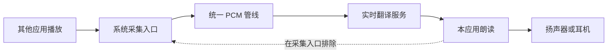

实时翻译应用有一条很容易形成回环的链路：采集电脑正在播放的声音，送给模型翻译，再把译文朗读出来。普通系统声音录制会把这段朗读一起收进去，模型又翻译一次，声音越播越多。

[ReaLingo](https://github.com/noSugarK/ReaLingo) 为这件事做了四种平台实现。值得复用的经验是：**优先在系统采集入口排除自己的播放来源，再把各平台得到的音频汇入同一条处理管线。**

本文按 2026-11-09 本地源码快照 `c01e68e` 整理，应用版本为 `0.8.0`。文中的源码链接固定到该提交；代码存在、测试存在与目标设备已经验证是不同的证据。本次整理没有重新运行音频硬件测试。

系列另两篇：[跨平台与 Android 适配]()、[实时会话、字幕与验证]()。

## 1. 先分清要过滤的是什么

系统声音过滤在这里指的是“采集其他程序，排除本应用”，与麦克风降噪、回声消除、人声分离是不同问题。



如果已经拿到所有应用混合后的波形，再尝试删除自己的声音，就要处理播放延迟、重采样、混音和音量变化。能够按进程或 UID 排除时，直接使用系统提供的来源过滤更合适。

这也解释了为什么“朗读时暂停录音”只适合某些交互：它会同时漏掉其他程序在这段时间播放的原声。连续同传通常需要采集与朗读并行。

| 平台 | 项目采用的系统声音路径 | 自身声音处理 | 条件和边界 |
| --- | --- | --- | --- |
| Windows | 普通 WASAPI loopback；需要排除时走 process loopback | 排除当前进程树 | 项目只对选中默认输出的情况切换专用路径；还需满足 API 的系统版本要求 |
| macOS | 自建 Core Audio process tap 和私有聚合设备，再交给 cpal | 将自身 Core Audio process object 加入排除列表 | 系统声音功能要求 macOS 14.4+，并涉及独立授权 |
| Linux | `pactl` 枚举 monitor，`parec` 输出 PCM | 当前实现没有来源排除 | 界面阻止“系统声音 + 朗读”组合 |
| Android | MediaProjection + AudioPlaybackCapture + AudioRecord | 排除本应用 UID | Android 10+，每次会话授权，且目标应用允许被捕获 |

这是项目当前的能力表。Linux 可以进一步设计虚拟音频路由，但本项目没有实现，不能把“尚未实现”写成操作系统永远不支持。

## 2. Windows：端点回环和进程回环要分开

cpal 的普通 WASAPI loopback 可以录制输出端点的混音，适合“把这个输出设备正在播放的内容录下来”。它会包含自己的朗读。

项目在需要朗读时，使用 `ActivateAudioInterfaceAsync` 激活 `VIRTUAL_AUDIO_DEVICE_PROCESS_LOOPBACK`，并传入以下配置。下面是源码中的关键字段摘录，并非完整可运行程序：

```rust
TargetProcessId: std::process::id(),
ProcessLoopbackMode: PROCESS_LOOPBACK_MODE_EXCLUDE_TARGET_PROCESS_TREE,
```

这里排除的是进程树，不是按声音频率过滤。项目通过 `audio::start` 统一分流，专用实现留在 [audio/wasapi.rs](https://github.com/noSugarK/ReaLingo/blob/c01e68ea01545b7ebc27c0a4efc17c0fb6031ac2/src-tauri/src/audio/wasapi.rs)。

### 2.1 不要把进程回环当作任意端点的等价替代

项目的 `audio::start` 仅在 `exclude_self` 为真、且用户选中默认输出设备时使用这条路径；其他设备仍走普通采集。

复用时应重新核对播放路由和采集范围。进程回环的筛选对象是进程，不能仅凭它与普通 loopback 都返回 PCM，就推断两者的设备选择语义相同。

系统版本也要查实际 API 要求。项目旧注释写过“Windows 10 2004+”，不能把它直接当成部署承诺；微软的 [Application loopback 示例](https://learn.microsoft.com/en-us/samples/microsoft/windows-classic-samples/applicationloopback/)标明需要 Windows build 20348 或更高。面向具体 Windows 版本发布时，应同时验证激活调用是否成功，并为失败提供明确提示。

### 2.2 FFI 的内存所有权会在停止时暴露问题

这条链路通过 `PROPVARIANT` 的 BLOB 传递参数。项目把 BLOB 指向栈上的激活参数，如果让绑定类型按默认析构逻辑清理，可能尝试释放这段不属于它的内存。

源码用 `ManuallyDrop` 避免错误释放。可迁移的经验是：**跨 FFI 边界先写清楚谁分配、谁释放、指针要活多久，再决定包装方式。** `ManuallyDrop` 只是这处所有权安排的具体措施，不能普遍用来掩盖析构问题。

另外两处细节也值得保留：异步激活回调实现 `IAgileObject`；采集等待使用有限超时，避免机器静音、没有新数据时无法响应停止。

## 3. macOS：回调在运行，也可能一直是静音

项目没有直接依赖 cpal 0.17 的默认系统声音 tap，而是在 [audio/tap.rs](https://github.com/noSugarK/ReaLingo/blob/c01e68ea01545b7ebc27c0a4efc17c0fb6031ac2/src-tauri/src/audio/tap.rs) 创建原生 tap，再把聚合设备作为普通输入交给 cpal。

开发记录中，系统声音一直静音至少涉及两类原因：

- 录音权限与系统声音权限分开，应用包需要对应的 `NSMicrophoneUsageDescription`、`NSAudioCaptureUsageDescription`。
- 项目使用的 cpal 0.17 路径没有开启所需的 tap 自动启动，创建流成功后仍收不到有效声音。

因此，诊断不能只看 `build_input_stream` 或 `play()` 有没有报错。还要检查授权、tap 是否启动、PCM 是否到达，以及数据是否始终为零。

### 3.1 自建 tap 的完整生命周期

项目的处理顺序是：

1. 解析用户选择的输出设备标识，去掉应用自己的 `sys|` 前缀。
2. 需要排除自身时，将 PID 转换为 Core Audio process object。
3. 创建带排除列表的 process tap。
4. 创建私有 aggregate device，启用 `kAudioAggregateDeviceTapAutoStartKey`。
5. 有限等待聚合设备出现在设备列表中，并确认它具备输入能力。
6. 用 cpal 读取；结束时先释放流，再销毁聚合设备和 tap。

这里出现过一个很典型的时序坑：**创建系统对象成功，不代表另一个 API 立刻能枚举到它。** 项目使用最多 40 次、每次间隔 50 ms 的就绪检查，而不是创建后马上查找一次。

这些对象由 `Tap` 持有，`Drop` 负责清理。聚合设备创建失败时，已经创建的 process tap 也会被销毁，避免只顾成功路径。

### 3.2 先初始化播放器，再创建排除列表

如果本应用尚未成为 Core Audio 客户端，按 PID 查询自身音频 process object 可能失败。项目在 Rust 的 `start_stream` 中先创建 `Player`，再开始采集。

这种初始化顺序应写在负责组装资源的入口处，并留下原因。否则后续重构很容易为了“先录音再播放”而调换顺序，重新引入问题。

历史提交可对照：[系统声音统一改走自建 tap](https://github.com/noSugarK/ReaLingo/commit/20c5fa1)、[等待聚合设备就绪](https://github.com/noSugarK/ReaLingo/commit/b8ec413)。这些属于已修复案例。

## 4. Linux：设备枚举为空，不一定是没有设备

Linux 上，cpal 使用的 ALSA 路径不会直接枚举 PulseAudio/PipeWire 的 monitor source。继续在 ALSA 输入列表里查找“系统声音”，容易误判为系统不支持。

项目的 [audio/pulse.rs](https://github.com/noSugarK/ReaLingo/blob/c01e68ea01545b7ebc27c0a4efc17c0fb6031ac2/src-tauri/src/audio/pulse.rs) 采用现成工具完成这件事：

```text
pactl info
  检查声音服务器是否可达
pactl list sources
  找到 Monitor of Sink 不为 n/a 的 source
parec -d <source> --format=s16le --rate=<目标采样率> --channels=1
  从 stdout 读取 PCM
```

PipeWire 提供 PulseAudio 兼容服务时也能走这条路径。其前提是相关工具和服务可用；DEB/RPM 打包也要声明相应运行依赖。

### 4.1 中文系统会把命令输出的字段名翻译掉

代码最初按 `Name:`、`Description:`、`Monitor of Sink:` 解析输出，中文桌面可能得到“名称：”等本地化字段，结果是设备真实存在，应用列表却为空。

项目对 `pactl` 子进程设置 `LC_ALL=C`，固定被解析的输出语言。这条经验适用于任何解析 CLI 人类可读输出的程序：优先使用结构化输出；确需解析文本时，明确 locale、分隔符与失败行为。

设备标识也不要直接保存显示名称。项目保存实际 source 名称，把描述留给界面展示；默认设备选择还会检查对应 monitor 是否仍存在，避免热插拔后保留无效选项。

### 4.2 把当前做不到的组合表达清楚

当前 Linux monitor 路径会收到整个输出的混音，因此前端在选择系统声音时禁用朗读并给出原因。麦克风与文件输入可以独立判断是否允许朗读。

这是一个实用的产品取舍：能力限制落实到操作入口，用户能理解为什么不能启用。后续若实现虚拟输出或独立路由，再扩展能力，而不是先把开关做成看似可用。

## 5. Android：按 UID 排除，并尊重目标应用的捕获策略

Android 系统声音走 [SubtitleService.kt](https://github.com/noSugarK/ReaLingo/blob/c01e68ea01545b7ebc27c0a4efc17c0fb6031ac2/src-tauri/android/SubtitleService.kt)，关键配置如下：

```kotlin
val config = AudioPlaybackCaptureConfiguration.Builder(p)
    .addMatchingUsage(AudioAttributes.USAGE_MEDIA)
    .addMatchingUsage(AudioAttributes.USAGE_GAME)
    .addMatchingUsage(AudioAttributes.USAGE_UNKNOWN)
    .excludeUid(android.os.Process.myUid())
    .build()
```

这里的 `p` 是本次会话授权得到的 `MediaProjection`。服务按 48 kHz、单声道、PCM16 读取音频，经 JNI 交给 Rust 的统一处理管线；排除自身 UID 用于避免再次采集应用朗读。

授权成功并不意味着所有 App 的声音都可以录。受保护媒体、通话或禁止捕获的应用仍可能没有声音。Android 的[播放音频捕获文档](https://developer.android.com/media/platform/av-capture)解释了这些条件。

验证时至少分清四件事：系统授权已完成、录音器进入 recording、PCM 帧已经到达、捕获到非静音的目标声音。前三项通过不能替代最后一项。

后台采集交给原生前台服务持有，投影撤销、读音频失败和主动停止都需要清理 `AudioRecord`、`MediaProjection`。网页定时器在后台可能暂停，不适合作为唯一的资源释放机制。

## 6. 平台适配之后，统一音频格式

平台层负责回答“从哪里拿到允许采集的声音”；模型协议层负责回答“需要什么格式”。项目中间使用统一 PCM 管线：

```text
设备帧 → 转换为 f32 → 多声道混为单声道
      → 持续重采样 → i16 → 每 100 ms 分块 → 有界上传队列
```

[resample.rs](https://github.com/noSugarK/ReaLingo/blob/c01e68ea01545b7ebc27c0a4efc17c0fb6031ac2/src-tauri/src/resample.rs) 保留跨块历史和小数采样位置，使用窗函数 sinc 做重采样；项目协议配置中部分路径用 16 kHz，OpenAI 路径用 24 kHz。这些是该快照的配置，接其他服务时仍需查其格式要求。

48 kHz 降到 16 kHz 不能简单理解为每三个样本取一个：没有低通滤波会产生混叠，44.1 kHz 转 16 kHz 还涉及非整数比例。

实时回调使用 `try_send`，队列满时丢弃音频块，避免网络反压阻塞音频线程。这个取舍会损失内容；它适合优先维持实时性的场景，离线文件转写应另行设计可靠传输。

## 7. 后续项目可直接复用的检查顺序

| 现象 | 优先检查 | 能证明问题解决的证据 |
| --- | --- | --- |
| 系统声音列表为空 | 枚举使用的音频后端、声音服务、CLI locale | 目标设备实际出现且可打开 |
| 流启动但没有字幕 | 权限、tap 启动、帧数量、输入电平、上传与服务确认 | 分层确认声音到达服务并返回文字 |
| 朗读被再次翻译 | 实际使用的过滤路径、进程/UID、输出路由 | 自身测试音被排除，其他程序声音仍可采集 |
| 静音时停止无响应 | 无限等待、阻塞读取、停止信号的检查位置 | 无新音频包时仍能结束并释放资源 |
| 多次启停后异常 | FFI 所有权、聚合设备、子进程与录音器清理 | 连续启停并检查资源与崩溃日志 |

项目在 WASAPI 模块中保留了一个默认忽略的硬件测试：播放自己的测试音，比较普通回环与排除模式的峰值。它需要真实音频设备和安静环境，存在测试代码不代表普通 CI 已经执行。完整验证还应加入其他进程的声音，确认过滤没有把目标音源一起丢掉。

## 源码入口

- [统一采集入口、设备选择和 PCM 管线](https://github.com/noSugarK/ReaLingo/blob/c01e68ea01545b7ebc27c0a4efc17c0fb6031ac2/src-tauri/src/audio/mod.rs)
- [播放器与采集的初始化顺序](https://github.com/noSugarK/ReaLingo/blob/c01e68ea01545b7ebc27c0a4efc17c0fb6031ac2/src-tauri/src/lib.rs)
- [Linux 朗读组合限制](https://github.com/noSugarK/ReaLingo/blob/c01e68ea01545b7ebc27c0a4efc17c0fb6031ac2/src/core/session.ts)
- [macOS 权限声明](https://github.com/noSugarK/ReaLingo/blob/c01e68ea01545b7ebc27c0a4efc17c0fb6031ac2/src-tauri/Info.plist)
