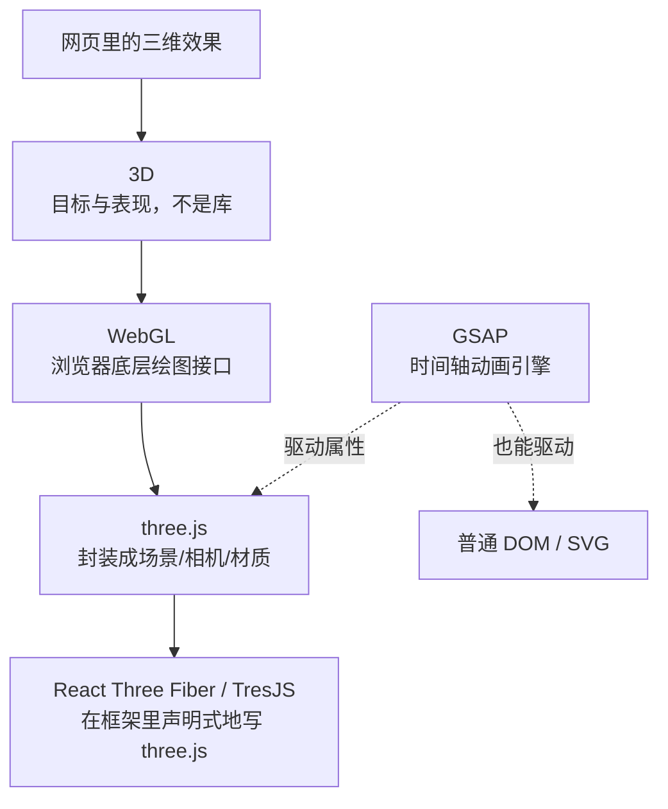
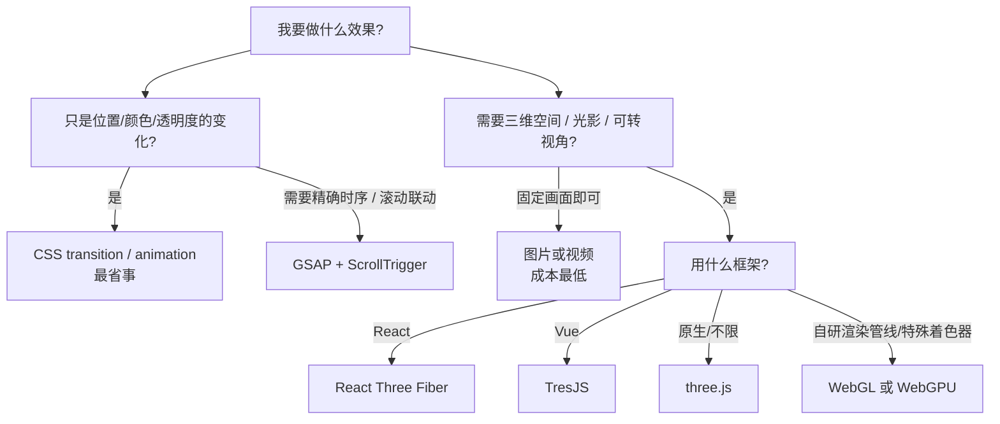

做前端页面时，常常缺的不是一个按钮，而是按钮按下后的反馈、列表切换时的过渡，或者首屏里恰到好处的一段动画。

React Bits、Aceternity UI、GSAP、Uiverse 都能帮上忙，但它们的使用方式差别很大：有的直接复制组件，有的提供动画 API，有的是设计素材平台，还有的是用代码生成视频的工具。

这篇想当成一份能反复查的手册：先看清几个名字之间的关系，再知道每类东西用来干什么、什么时候该用谁，最后动手跑第一段代码。常用资源按用途整理在后面，可以先按技术栈找入口，不必把整份清单都装进项目。

想先弄清「滚动触发」「布局过渡」这些词指的是什么？先去[前端动效入门实验台]()亲手试，再回来看怎么选工具。

> 整理日期：2026-11-18，2026-11-23 补充概念关系、选型图与上手示例。组件数量、价格、包体积和授权条款可能变化，本文不把这些数字当作固定结论；接入前以对应项目的官方文档、仓库和许可证为准。

## 0. 先认清几个名字：它们不是并列关系

搜索「网页 3D 效果」，会同时撞上 3D、WebGL、three.js、GSAP。它们常被并列推荐，但并不是同一类的四个选项——把它们当成四选一，是新手最容易绕的弯路。

**一句话记住：WebGL 是地基，three.js 是建在地基上的房子，React Three Fiber / TresJS 是用框架的方式盖房子，GSAP 是负责让东西按时间动起来的导演。**「3D」只是这类效果的总称，不是某个具体的库。



有两条线要分开记：

- **纵向是渲染线**：3D → WebGL → three.js → 框架封装。越往上越好写，越往下控制力越强、要自己操心的事也越多。
- **横向是动画线**：GSAP。它不管画面是 2D 还是 3D，只负责「在什么时间把什么属性变成什么值」，所以既能动普通按钮，也能动 three.js 里的相机和模型。

| 名字 | 是什么 | 用来干什么 |
| --- | --- | --- |
| 3D | 一种表现目标，不是库 | 能转视角的产品、有光影的空间、可换角度的模型 |
| WebGL | 浏览器给 GPU 的低层接口 | 自研渲染引擎、写特殊着色器、精细控制性能 |
| three.js | 把 WebGL 封装成好用的对象 | 产品展示、数据可视化、加载 glTF 模型的 3D 场景 |
| React Three Fiber / TresJS | 框架里声明式地写 three.js | React / Vue 项目中的 3D，和组件生命周期结合 |
| GSAP | 时间轴动画引擎 | 首屏分步入场、滚动叙事、SVG 动画、镜头编排 |

## 1. 先看你要解决什么问题

| 需求 | 优先看 | 使用方式 |
| --- | --- | --- |
| React 页面快速加入背景、文字和卡片动效 | React Bits、Aceternity UI、Magic UI | 挑选组件，按文档复制源码或安装 |
| React 产品界面的状态切换、布局和进出场 | Motion、Motion Primitives、Animate UI | 用动画 API、组合组件，或给现有 primitive 换带动画的 import |
| Vue 3 页面加入展示型动效 | Inspira UI、Vue Bits | 使用 Vue 版本组件 |
| Vue 中已有组件需要动画能力 | VueUse Motion、Animate UI（Vue） | 给自己的组件添加动画，或给 shadcn-vue 的 primitive 换 import |
| 原生 HTML 页面需要按钮、加载与悬浮反馈 | Uiverse、CSS 原生能力 | 复制片段并调整样式 |
| 多段动画需要严格衔接，或与滚动联动 | GSAP、Anime.js | 编写时间轴、触发和更新逻辑 |
| 平滑滚动 | Lenis | 接入滚动控制工具 |
| 3D 场景、粒子、材质和着色器 | React Three Fiber、TresJS | 构建和维护 WebGL 场景 |
| 播放设计师交付的动画 | Lottie、Rive | 导入动画文件，接入播放器或运行时 |
| 生成宣传片、字幕视频、批量视频 | Remotion | 用 React 定义内容并渲染视频 |
| 找组件结构和视觉参考 | 21st.dev | 浏览案例，再检查具体组件的代码与依赖 |

**组件库负责提供起点，动画引擎负责控制变化，素材格式与视频框架负责另一类交付。** 先分清这几类，选型会容易很多。

如果上面的表格还不好判断，按下面的流程走一遍：**先问要不要三维，再问要不要精确编排，最后才问用什么库。**



## 2. React：优先找能直接改的组件

这一组的共同点是能直接看到源码、复制进项目再改。名字就是入口，点进去看演示，再按最后一列核对成本。

| 资源 | 适合什么 | 上手前留意 |
| --- | --- | --- |
| [React Bits](https://reactbits.dev/) · [源码](https://github.com/DavidHDev/react-bits) | 文字、背景、交互和展示组件，适合个人主页与落地页 | 逐个看依赖和运行成本，简单文字动画和持续渲染的背景不是一回事 |
| [Aceternity UI](https://ui.aceternity.com/) | 聚光灯、卡片悬浮、文字动效等视觉表现较强的页面 | 常带 Tailwind CSS 与 Motion 依赖；免费与付费授权分开看 |
| [Magic UI](https://magicui.design/) | 文字、边框、卡片、背景，常配 Tailwind 与 shadcn/ui | 已有基础组件就只挑少量补，复制后检查颜色变量、暗色主题与依赖 |
| [Motion Primitives](https://motion-primitives.com/) | 文字变化、内容展开、界面切换等局部交互 | 比大面积持续运动的背景更容易融进业务界面 |
| [Animata](https://animata.design/) | 找某个局部效果的实现思路 | 触发条件、容器尺寸、状态和依赖要一起读，别只抄最显眼的部分 |
| [Animate UI](https://animate-ui.com/) · [Vue 版文档](https://animate-ui.com/docs/vue) | 给已有 Radix / Base UI / React Aria（Vue 是 Reka UI）的 primitive 加动画，保留原组件结构与 API | CLI 换 import 即可；动效克制且默认尊重减少动态偏好，先看它是否覆盖你在用的组件 |
| [DitherUI](https://ditherui.dev/) | React / shadcn 生态的动画组件与整页 Blocks、AI Agent 界面 | 复制式源码、CLI 安装，基于 TypeScript + Tailwind + Motion；内容是 $50 一次性付费解锁，授权以官网为准 |
| [Motion](https://motion.dev/) · [React 文档](https://motion.dev/docs/react) | 动画能力层：进出场、布局、手势、滚动 | 旧称 Framer Motion，现用 `motion` 包与 `motion/react` 导入，接入前先核对已有项目的版本 |

挑一个能服务内容的重点效果，统一字体、颜色和间距；把多个完整演示拼在一起，页面很容易失去一致性。要现成的背景组件先看 React Bits，要控制自己组件的动画状态再看 Motion。

## 3. Vue：组件版本和动画能力分开选

Vue 的基础工程与业务组件选型，可以结合 [Vue 3 前端实用指南]() 阅读。下面这些资源补的是动效能力。

| 资源 | 适合什么 | 上手前留意 |
| --- | --- | --- |
| [Inspira UI](https://inspira-ui.com/) | Vue 生态的展示与动效组件：背景、卡片、文字 | 先确认适配自己的 Vue / Nuxt、样式方案，是否含浏览器专用 API |
| [Vue Bits](https://vue-bits.dev/) | 类似 React Bits 的文字、背景和交互，找现成 Vue 实现 | 有 Vue 版本就别手动翻译 React Hooks 和生命周期，更容易维护 |
| [Animate UI（Vue）](https://animate-ui.com/docs/vue) | 给 shadcn-vue 的 Reka UI primitive 加动画，换 import 不改结构与 API | 基于 Motion for Vue，和你 shadcn-vue 的样式方案无关；与 React 版是同一项目的两套实现 |
| [VueUse Motion](https://motion.vueuse.org/) | 给已有组件加进入、悬浮、状态变化的声明式动画 | 保留自己的组件结构；与 motion.dev 的 Vue 方案是不同项目，别混用 |

Vue 组件也可能依赖 Canvas 或 WebGL，不能仅凭框架名称判断性能；统一一批业务组件的动画规则时，VueUse Motion 这种"保留结构、只加行为"的方式更方便。

## 4. 通用动画、滚动交互和微交互

这一组不挑框架，核心是"用 JavaScript 精确控制变化"。

| 资源 | 适合什么 | 上手前留意 |
| --- | --- | --- |
| [Anime.js](https://animejs.com/) | JS 控制属性、SVG、数值变化，组织时间轴与交错动画 | 不要求框架；核对版本，别混用不同大版本的 API；“多少 KB”要结合导入与构建方式看 |
| [GSAP](https://gsap.com/) · [文档](https://gsap.com/docs/v3/) · [ScrollTrigger](https://gsap.com/docs/v3/Plugins/ScrollTrigger/) | 多阶段时间轴、SVG、滚动触发与进度联动等复杂编排 | 组件卸载、页面切换、断点变化时清理或重建动画 |
| [Lenis](https://lenis.dev/) · [源码](https://github.com/darkroomengineering/lenis) | 平滑滚动，配合滚动动画 | 本身不做卡片、文字、背景动效；测试锚点、键盘、触摸和返回位置，长文章可保留原生滚动 |
| [Uiverse](https://uiverse.io/) · [源码](https://github.com/uiverse-io/galaxy) | 浏览社区样式与 CSS 交互片段 | 官网核对时拒绝自动访问，以实际页面为准；每个作品单独查代码与授权 |

GSAP 适合这样的场景：产品介绍区依次展示图片、标题和说明，再让滚动进度控制整段播放。简单的悬浮、颜色变化和淡入淡出，其实不必上库——优先用 CSS [`transition`](https://developer.mozilla.org/en-US/docs/Web/CSS/transition) 与 [`animation`](https://developer.mozilla.org/en-US/docs/Web/CSS/Guides/Animations)，要 JS 控制播放再看 [Web Animations API](https://developer.mozilla.org/en-US/docs/Web/API/Web_Animations_API)。[View Transition API](https://developer.mozilla.org/en-US/docs/Web/API/View_Transition_API) 和 [CSS 滚动驱动动画](https://developer.mozilla.org/en-US/docs/Web/CSS/CSS_scroll-driven_animations) 也值得关注，但要评估浏览器支持，并保留没有动画时的正常路径。

## 5. 3D、设计动画与视频

这一组的目标各不相同：前两行是 3D 场景，中间两行是设计师交付的动画文件，最后一行交付的是视频。先分清要的是哪一种。

| 资源 | 适合什么 | 上手前留意 |
| --- | --- | --- |
| [React Three Fiber](https://r3f.docs.pmnd.rs/) / [TresJS](https://tresjs.org/) · [Three.js](https://threejs.org/) | 可交互模型、粒子、光照、材质；前两者分别对接 React / Vue | 要维护场景、相机、模型资源和渲染循环；固定画面可先比一比视频或静态图 |
| [Lottie](https://github.com/airbnb/lottie-web) · [素材](https://lottiefiles.com/) | 接入设计师做的矢量动画：加载、成功反馈、功能引导 | 播放器许可与素材许可分开看；确认效果能导出、播放器支持、文件实际大小 |
| [Rive](https://rive.app/) · [文档](https://rive.app/docs/) | 有状态和输入响应的交互动画，如角色切换动作、图标过渡 | 分别看编辑器、协作服务、运行时和素材要求；与设计师先定状态、输入和触发方式 |
| [Remotion](https://www.remotion.dev/) · [文档](https://www.remotion.dev/docs/) | 用 React 按帧渲染视频：宣传片、数据视频、字幕、批量内容 | 主要交付物是视频，考虑帧率、时长、音频、字体、渲染耗时；看当前许可证，别默认免费 |

Rive 这类有状态变化的动画，跟设计师一起把状态、输入和触发方式定清楚，往往比前端拿到文件再反推省事。Remotion 用 React 不等于所有用途都免费，授权以当前条款为准。

## 6. 聚合站、动效片段与 AI 界面组件

聚合站里的组件来自不同作者，框架、依赖和许可各不相同——选中之后要继续看具体来源，别把整个平台当成一套统一维护的动画库。

| 资源 | 适合什么 | 上手前留意 |
| --- | --- | --- |
| [21st.dev](https://21st.dev/) | 浏览社区组件和页面片段，找结构、视觉、交互参考 | 也可结合其 AI 工具探索方案；逐个查来源，别当作统一动画库 |
| [OriginKit](https://www.originkit.dev/) | 可浏览、复制的动效组件，另有 Framer 与 MCP 入口 | 这里的 Framer 是设计工具，不等于 Framer Motion；接入 React 仍要看具体依赖 |
| [AICSS](https://www.aicss.dev/) | AI 应用界面：对话、思考态、工具调用、流式输出、引用 | 提供 React / Vue / Svelte 入口；检查长文本、流式更新、工具状态与失败反馈能否清楚呈现 |

开发聊天助手或 Agent 产品时，AICSS 这类面向 AI 界面的资源比纯装饰动效更贴近业务。

## 7. 按项目选一套够用的组合

| 项目 | 可以先试的组合 | 重点检查 |
| --- | --- | --- |
| React 个人主页、产品落地页 | React Bits、Magic UI 或 DitherUI，按需补 Motion | 首屏资源、视觉一致性、移动端；DitherUI 需付费解锁 |
| 已有 shadcn 组件只想加动效 | Animate UI（React 换 Radix 等 import，Vue 换 Reka UI import） | 是否覆盖你在用的 primitive、与现有样式是否一致 |
| Vue 3 / Nuxt 展示站 | Inspira UI 或 Vue Bits | SSR、浏览器 API、组件依赖 |
| 后台和工具产品 | 现有业务 UI 库 + CSS；复杂状态变化再用 Motion、VueUse Motion 或 Animate UI | 表单、焦点、加载与错误反馈 |
| 滚动叙事页面 | GSAP + ScrollTrigger；需要时再加 Lenis | 触摸操作、内容可达性、滚动恢复 |
| 交互式 3D 产品展示 | React Three Fiber 或 TresJS | 模型大小、显存、帧率与静态替代 |
| 设计团队交付动画 | 根据导出内容选择 Lottie 或 Rive | 格式支持、状态接口、素材许可 |
| 批量生成视频 | Remotion | 渲染时间、字体与音频、输出规格 |

同一页面尽量明确每个工具的职责。例如 Motion 处理卡片状态，GSAP 编排一段独立滚动场景；不要让两套系统同时修改同一元素的 `transform`。

## 8. 怎么上手：几段能单独跑的最小示例

选定之后，每节给一个可交互示例和可复制代码。示例从 CDN 加载依赖，失败也不影响你复制代码自己跑。**按选型结果看对应那段即可。**

### 8.1 three.js：一个旋转的立方体

拖动换角度，按钮换色或暂停。卡片内可切「示例 / 代码」，右上角图标放大。

<div class="demo-lab" data-demo="three"></div>

```html
<!doctype html>
<html lang="zh-CN">
<meta charset="utf-8">
<style>html,body{margin:0;height:100%} canvas{display:block}</style>
<script type="importmap">
{ "imports": { "three": "https://unpkg.com/three@0.160.0/build/three.module.js" } }
</script>
<script type="module">
import * as THREE from 'three';
const scene = new THREE.Scene();
const camera = new THREE.PerspectiveCamera(60, innerWidth / innerHeight, 0.1, 100);
camera.position.z = 3;
const renderer = new THREE.WebGLRenderer({ antialias: true });
renderer.setSize(innerWidth, innerHeight);
document.body.appendChild(renderer.domElement);

const cube = new THREE.Mesh(
  new THREE.BoxGeometry(),
  new THREE.MeshStandardMaterial({ color: 0x4a90d9 })
);
scene.add(cube);
scene.add(new THREE.AmbientLight(0xffffff, 1.5));
const light = new THREE.DirectionalLight(0xffffff, 2);
light.position.set(2, 3, 4);
scene.add(light);

renderer.setAnimationLoop(t => {
  cube.rotation.x = t * 0.001;
  cube.rotation.y = t * 0.0015;
  renderer.render(scene, camera);
});
</script>
```

三段骨架记牢就能搭出大部分场景：**场景 + 相机 + 渲染器**是舞台，**几何体 + 材质 = 网格**是演员，**灯光和渲染循环**让它可见、动起来。

### 8.2 GSAP：时间轴与滚动

色块按时间轴入场；拖进度可定位、倒放，可调速。

<div class="demo-lab" data-demo="gsap"></div>

```html
<script src="https://cdn.jsdelivr.net/npm/gsap@3.12.5/dist/gsap.min.js"></script>
<script src="https://cdn.jsdelivr.net/npm/gsap@3.12.5/dist/ScrollTrigger.min.js"></script>
<script>
gsap.registerPlugin(ScrollTrigger);
// 依次入场，后一段与前一段重叠 0.2 秒
gsap.timeline()
  .from('h1', { y: -30, opacity: 0, duration: 0.5 })
  .from('.card', { y: 20, opacity: 0, stagger: 0.1 }, '-=0.2');
// 滚动多少，进度条就走多少，往回滚会倒放
gsap.to('.progress', {
  scaleX: 1, ease: 'none',
  scrollTrigger: { trigger: '.section', start: 'top top', end: 'bottom top', scrub: true }
});
</script>
```

时间轴的价值在 `'-=0.2'` 这种相对位置和 `scrub` 这种跟滚动绑定，用 `setTimeout` 手写很难对齐。

### 8.3 两者组合：让滚动驱动相机

**three.js 画，GSAP 动**。框内滚动滚轮（或拖滑块、自动播放），镜头穿过一排展台：

<div class="demo-lab" data-demo="combo"></div>

```js
// 进度 0→1：相机 z 从 5 拉到 -11，穿过一排展台；渲染仍由 three.js 的循环负责
function apply(p) {
  gsap.set(camera.position, {
    z: 5 - p * 16,
    x: Math.sin(p * Math.PI * 2) * 0.45,
    y: Math.cos(p * Math.PI) * 0.25
  });
  camera.lookAt(0, 0, camera.position.z - 4);
}
// 真实页面里把 p 换成滚动进度：
// ScrollTrigger.create({ trigger: '#showcase', start: 'top top', end: '+=3000', scrub: 1,
//   onUpdate: self => apply(self.progress) });
```

职责不要重叠：让 GSAP 改属性，让 three.js 渲染，**不要让两个系统同时改同一个元素的 `transform`**。

### 8.4 WebGL：看看地基长什么样

日常不必自己写。下面是原生 WebGL 的三色渐变三角，旋转与渐变都在着色器里算，CPU 每帧只传一个角度：

<div class="demo-lab" data-demo="webgl"></div>

```js
const gl = canvas.getContext('webgl');
// 顶点着色器：按 uAngle 旋转顶点，并把顶点色传给片元着色器
const vs = `attribute vec2 p; attribute vec3 c; varying vec3 vC; uniform float uAngle;
  void main(){ float s=sin(uAngle), co=cos(uAngle);
    gl_Position=vec4(mat2(co,-s,s,co)*p, 0.0, 1.0); vC=c; }`;
// 片元着色器：直接输出插值后的顶点色 —— 三色渐变由此而来
const fs = `precision mediump float; varying vec3 vC;
  void main(){ gl_FragColor=vec4(vC,1.0); }`;
// 编译着色器 → 链接程序 → 传入顶点位置与顶点色 → 每帧 gl.uniform1f(uAngle, t) → drawArrays(...)
```

光是把这段跑通就要写好几倍于 three.js 例子的代码——这正是 three.js 存在的原因。

## 9. 复制组件之后，还要做什么

### 9.1 阅读依赖和源码

复制式组件进入仓库之后，就成为需要自己维护的代码。先确认它依赖哪些包、字体、图片和全局样式，再检查版本、主题变量与组件命名是否适合项目。

看到演示效果不等于完成接入。把默认文案换成真实内容，在容器宽度变化、长标题和空数据状态下再看一次。

### 9.2 用真实设备判断性能

优先检查持续运行的粒子、模糊、阴影、滤镜、Canvas 和 WebGL 效果。`transform` 与 `opacity` 往往更容易优化，但也不能据此保证整个页面流畅。

至少检查手机上的滚动与点击反馈、首屏资源，以及页面离开后动画是否停止。动画组件若需要持续计算，也要考虑不可见或后台状态下的暂停策略。

### 9.3 保留键盘操作和减少动态效果的体验

按钮要能通过键盘操作，悬浮内容不能只对鼠标用户开放，自定义光标不能成为唯一的操作提示。装饰层也不能遮住链接、文字或焦点。

针对系统的“减少动态效果”偏好，参考 [`prefers-reduced-motion`](https://developer.mozilla.org/en-US/docs/Web/CSS/@media/prefers-reduced-motion) 减少大幅位移、视差和持续运动；处理动态内容时保留必要的状态反馈。

### 9.4 分别确认代码、素材与服务的许可

开源代码、付费模板、动画素材、在线编辑器和 AI 生成功能可能采用不同条款。复制前找到具体项目或组件的许可证，涉及客户交付、模板转售和视频生成时，查看相应使用条件。

选择一个最能说明产品或帮助用户操作的效果，把内容、性能和交互做好，再决定是否需要第二个。

## 10. 一页速查

把这张表单独记下来，就能当技能卡用：看到需求 → 找到行 → 到对应章节找资源或代码 → 再用第 9 节逐条检查。

| 我看到的需求 | 第一反应 | 去哪节 |
| --- | --- | --- |
| 悬浮、淡入、小反馈 | CSS，`transition` / `@keyframes`，不必上库 | 第 4 节末（原生能力） |
| 依次入场、滚动联动 | GSAP + ScrollTrigger | 第 4 节 GSAP、8.2 |
| 可旋转的产品、3D 场景 | three.js（React / Vue 用封装层） | 第 5 节、8.1 |
| 3D 里的精确镜头运动 | three.js 画 + GSAP 动 | 8.3 |
| 自研渲染管线、特殊着色器 | WebGL / WebGPU | 8.4 只是起点 |
| 固定镜头的装饰画面 | 图片 / 视频，别维护渲染循环 | 第 0 节 |
| 设计师交付的动画文件 | Lottie / Rive | 第 5 节 |
| React / Vue 现成组件 | React Bits / Motion / Inspira UI，shadcn 组件加动效用 Animate UI | 第 2、3 节 |

> 这份速查表也可以当作给 AI 的描述底稿：把「需求 + 约束（框架、性能、无障碍）」写清楚，让它按表给出选型和第一段骨架代码，再对照第 9 节逐条检查。
